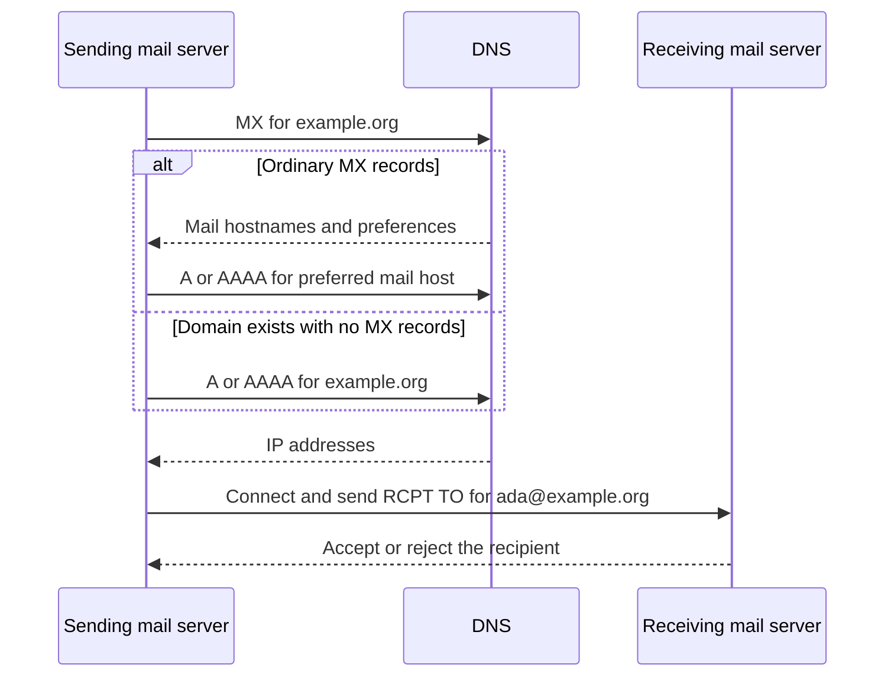
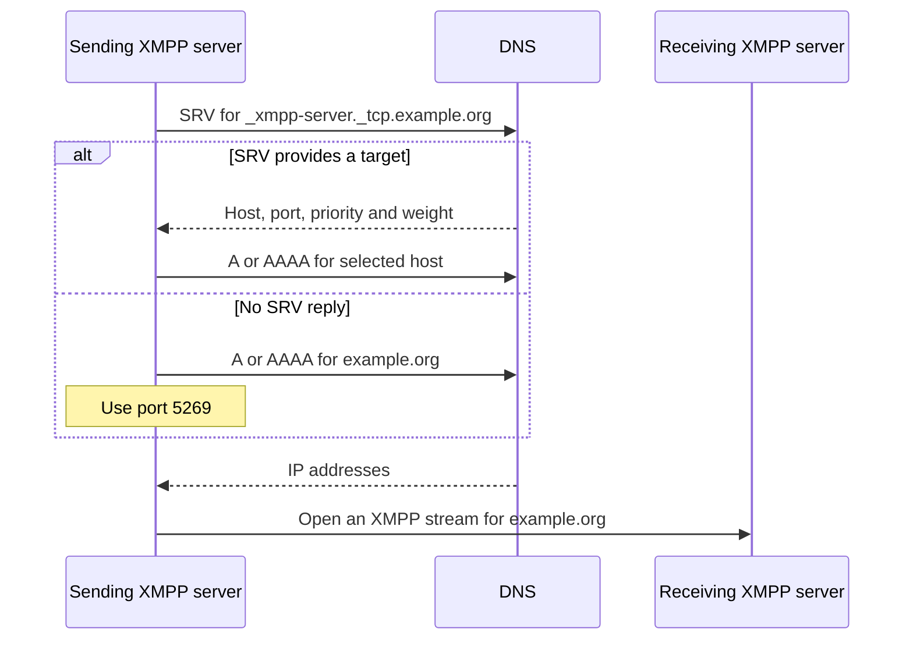
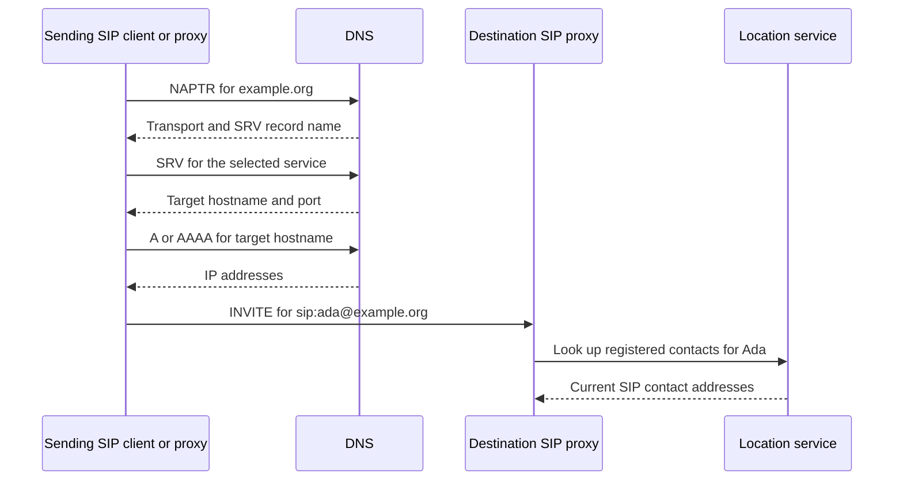
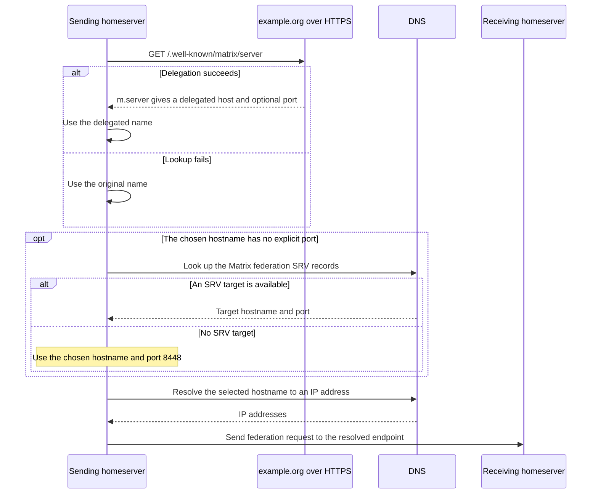
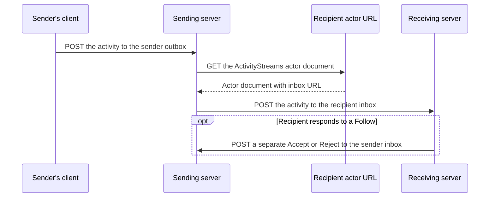
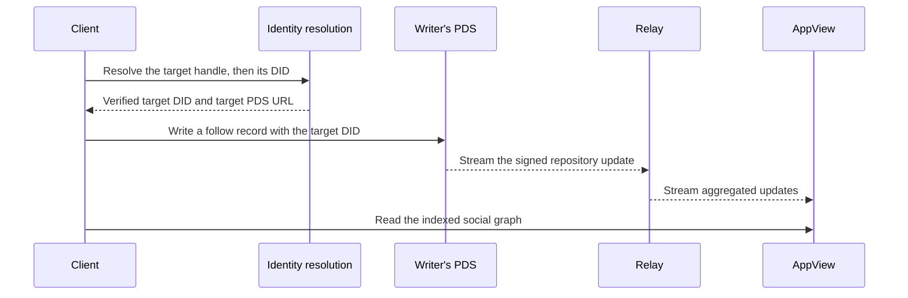
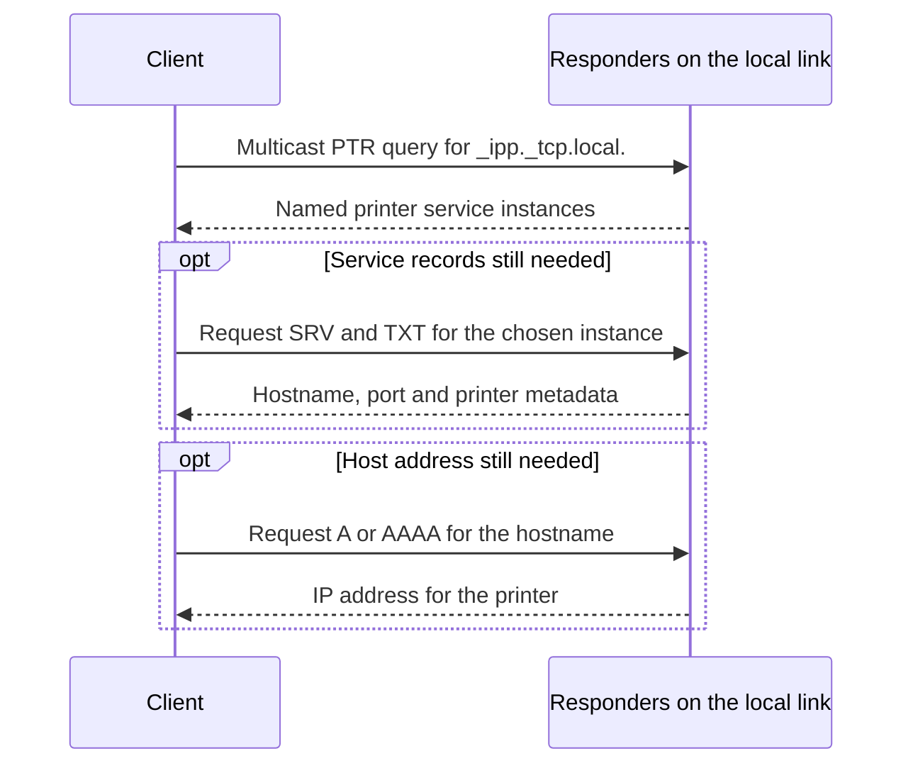
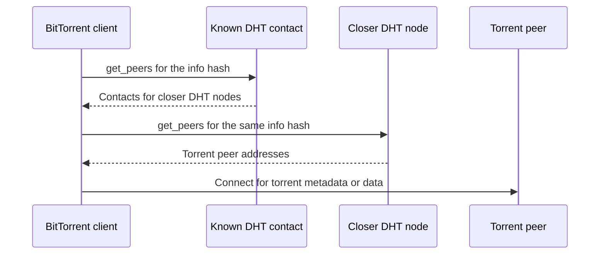
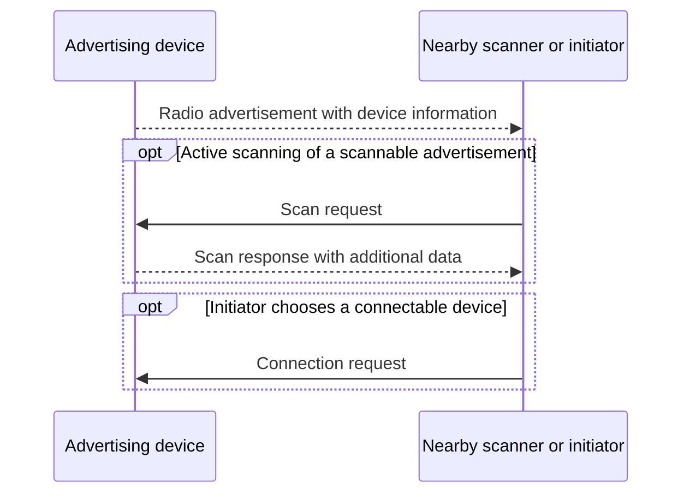
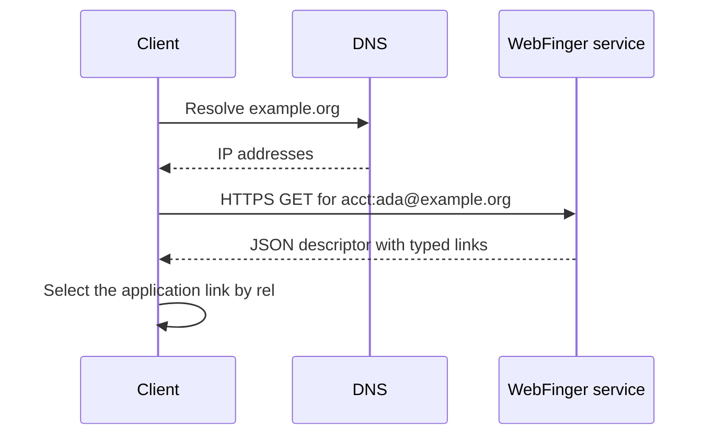

# Addressing and discovery methods

Neo-Alexandria has two discovery questions. Given a topic, which experts might help? Given an expert’s address, where should a client deliver the query? Most of the protocols here start from a known address. BitTorrent starts from a content identifier, and local service discovery can start from a service type.

Seven of these ten examples use conventional DNS when resolving domain names. Four use records such as `MX`, `SRV`, or `NAPTR` to select a server. AT Protocol can use a `TXT` record to resolve a handle to an account identifier. One example uses multicast DNS on the local network. Two can discover peers or devices through their own mechanisms.

| Protocol | Starting point | How it locates a destination |
| --- | --- | --- |
| [SMTP](#smtp) | Mailbox address | DNS `MX`, then address records |
| [XMPP](#xmpp) | Jabber ID | DNS `SRV`, then address records |
| [SIP](#sip) | SIP URI | DNS `NAPTR`, `SRV`, and address records |
| [Matrix](#matrix) | Homeserver name | HTTPS delegation and DNS |
| [ActivityPub](#activitypub) | Actor URL | HTTPS actor document gives the inbox URL |
| [AT Protocol](#at-protocol) | Account handle or DID | DNS or HTTPS resolves the handle. The DID document gives the data server URL. |
| [DNS-SD over mDNS](#dns-sd-over-mdns) | Local service type | Multicast DNS records describe service instances |
| [BitTorrent DHT](#bittorrent-dht) | Torrent info hash | A distributed hash table returns peer contacts |
| [Bluetooth LE](#bluetooth-le) | Devices within radio range | Devices advertise and scanners listen |
| [WebFinger](#webfinger) | Account or other entity URI | HTTPS lookup returns application-specific links |

## SMTP

To deliver to `ada@example.org`, the sending mail server looks up `MX` records for `example.org`. Each record gives a mail-server hostname and a preference value. The sender tries lower values first and resolves each selected hostname to IP addresses. If the domain exists and has no MX records, the sender uses the domain’s own address records. A domain can explicitly decline mail by publishing a null MX. [SMTP routing](https://datatracker.ietf.org/doc/html/rfc5321#section-5.1) · [Null MX](https://datatracker.ietf.org/doc/html/rfc7505#section-3)

After connecting, the sender supplies the full envelope address with `RCPT TO`. The receiving domain interprets `ada` and can route it to a mailbox, alias, or list. The sender gets the address itself from a contact, directory, or previous exchange. [SMTP addresses](https://datatracker.ietf.org/doc/html/rfc5321#section-2.3.11) · [Recipient command](https://datatracker.ietf.org/doc/html/rfc5321#section-4.1.1.3)

## XMPP

An address such as `ada@example.org` is a Jabber ID. For federation, the sending server queries `_xmpp-server._tcp.example.org` for `SRV` records. The records give target hostnames, ports, priorities, and weights. The sender orders the targets using those values, resolves their hostnames, and attempts a connection. If the lookup yields no SRV response, the normal fallback is the domain’s own `A` or `AAAA` records and TCP port `5269`. An SRV target of `.` explicitly indicates that the service is unavailable. [XMPP server resolution](https://datatracker.ietf.org/doc/html/rfc6120#section-3.2) · [SRV record rules](https://datatracker.ietf.org/doc/html/rfc2782)

Client-to-server connections use `_xmpp-client._tcp` and default to TCP port `5222`. Once an entity is reachable, XMPP’s Service Discovery extension lets a client ask which features that entity supports or which items it exposes, such as chat rooms. [XMPP server resolution](https://datatracker.ietf.org/doc/html/rfc6120#section-3.2) · [XMPP Service Discovery](https://xmpp.org/extensions/xep-0030.html)

## SIP

For a URI such as `sip:ada@example.org` with a domain and neither port nor transport specified, the sender first asks DNS for `NAPTR` records. The selected record identifies a compatible transport and the name of an `SRV` record. That `SRV` record supplies a hostname and port. The sender resolves the hostname with `A` or `AAAA` records and sends the SIP request to that endpoint. [SIP server discovery](https://datatracker.ietf.org/doc/html/rfc3263#section-4)

With an explicit transport, the sender can query the corresponding `SRV` service directly. With no `NAPTR` records, it tries `SRV` for supported transports. If neither lookup selects a transport, the usual defaults are UDP for `sip:` and TCP with TLS for `sips:`. If there is no `SRV` result, the sender uses the domain’s address records and the selected transport’s default port. An explicit port goes straight to address lookup and uses that port. A numeric IP can be used directly. [SIP transport selection](https://datatracker.ietf.org/doc/html/rfc3263#section-4.1) · [DNS fallbacks](https://datatracker.ietf.org/doc/html/rfc3263#section-4.2)

Once the request reaches the destination domain, a SIP proxy can look up `ada` in a location service. `REGISTER` requests associate the URI with current contact addresses. [SIP registration](https://datatracker.ietf.org/doc/html/rfc3261#section-10) · [Proxy target lookup](https://datatracker.ietf.org/doc/html/rfc3261#section-16.5)

## Matrix

Matrix federation resolves a homeserver name, such as `example.org` in `@ada:example.org`. For a hostname with no explicit port, the sending homeserver requests `https://example.org/.well-known/matrix/server`. A response such as `{"m.server":"matrix.example.net:443"}` delegates federation to that host and port. If the delegated name has no port, Matrix tries `_matrix-fed._tcp` SRV on that name, then the legacy `_matrix._tcp` record. If neither yields a target, it uses the delegated hostname on port `8448`. [Matrix server-name resolution](https://spec.matrix.org/latest/server-server-api/#resolving-server-names)

If `.well-known` lookup fails, the same SRV and address-record fallbacks apply to the original name. An original hostname with an explicit port goes straight to address lookup. An IP literal is used with its explicit port or `8448`. The resulting endpoint is where the sending homeserver makes its federation requests. [Matrix server-name resolution](https://spec.matrix.org/latest/server-server-api/#resolving-server-names)

## ActivityPub

An ActivityPub actor has a URI and an actor document that lists its inbox and outbox. A client can submit an ActivityStreams activity to its own actor’s `outbox`. For federation, the sending server uses the activity’s audience to identify recipients, fetches their actor documents, and sends the activity by HTTP `POST` to the inbox URLs it discovers. DNS resolves the hostnames in those URLs. Mastodon uses WebFinger to turn a handle such as `@ada@example.org` into an actor URL. [Actor objects](https://www.w3.org/TR/activitypub/#actor-objects) · [Client submission](https://www.w3.org/TR/activitypub/#client-to-server-interactions) · [Federated delivery](https://www.w3.org/TR/activitypub/#delivery) · [Mastodon WebFinger](https://docs.joinmastodon.org/spec/webfinger/)

A `Follow` goes to the target’s inbox. The recipient’s server can accept or reject it automatically or after review. An acceptance is a separate activity sent back to the follower. The recipient can then include that actor when delivering posts addressed to its followers. [Follow approval](https://www.w3.org/TR/activitypub/#follow-activity-inbox) · [Followers collection](https://www.w3.org/TR/activitypub/#followers)

## AT Protocol

Bluesky uses AT Protocol for its public social data. A handle such as `ada.example.org` resolves to a decentralized identifier (DID) through a DNS `TXT` record at `_atproto.ada.example.org` or an HTTPS request to `ada.example.org/.well-known/atproto-did`. The client can perform the lookup or ask a network service to do it. The resolver checks the DID document’s `alsoKnownAs` field for the matching handle. The document also gives the account’s signing key and the URL of its personal data server (PDS). AT Protocol supports `did:plc`, resolved through the PLC directory, and `did:web`, resolved over HTTPS. [Handle resolution](https://atproto.com/specs/handle#handle-resolution) · [DID document](https://atproto.com/specs/did)

The PDS hosts the account’s repository and signs its commits. An `at://` URI can identify a record by account, collection, and record key. Relays subscribe to updates from many PDSs and aggregate them into a stream. Bluesky’s AppView indexes that stream to serve feeds, search, and other views of the public records. [AT URI scheme](https://atproto.com/specs/at-uri-scheme) · [Repository specification](https://atproto.com/specs/repository) · [Relays and AppViews](https://atproto.com/guides/the-at-stack)

In Bluesky, following an account creates an `app.bsky.graph.follow` record in the follower’s own repository. The record points to the target’s DID, and the AppView indexes it as part of the public social graph. A post author can set reply permissions separately with an `app.bsky.feed.threadgate` record. [Follow record](https://raw.githubusercontent.com/bluesky-social/atproto/main/packages/api/lexicons/app/bsky/graph/follow.json) · [Threadgate record](https://raw.githubusercontent.com/bluesky-social/atproto/main/packages/api/lexicons/app/bsky/feed/threadgate.json)

## DNS-SD over mDNS

A client starts with a service type and a domain. To find Internet Printing Protocol printers on its local link, it sends a multicast `PTR` query for `_ipp._tcp.local.`. Responders return the names of available service instances. The client chooses an instance and obtains its `SRV` record for the hostname and port and its `TXT` record for service metadata. It resolves the hostname with `A` or `AAAA` records and connects. Responders can include those records in the initial reply to save additional queries. DNS-SD can also serve the same kinds of records through conventional DNS. [DNS-SD browsing and resolution](https://datatracker.ietf.org/doc/html/rfc6763#section-4) · [Multicast DNS](https://datatracker.ietf.org/doc/html/rfc6762)

## BitTorrent DHT

A magnet link identifies a torrent by its info hash. For a magnet with no tracker, BEP 9 points to the Mainline DHT in BEP 5. A client joins that DHT using saved routing contacts, configured bootstrap nodes, contacts learned from peers, or the `nodes` field of a trackerless `.torrent` file. DNS can resolve bootstrap hostnames. Clients starting from different contacts can reach the same DHT if those contacts lead into the same connected network. [Magnet links](https://www.bittorrent.org/beps/bep_0009.html) · [DHT bootstrap and peer extension](https://www.bittorrent.org/beps/bep_0005.html#bittorrent-protocol-extension) · [libtorrent bootstrap settings](https://www.libtorrent.org/reference-Settings.html#dht_bootstrap_nodes)

The client sends `get_peers` with the info hash to known nodes whose IDs are closest to the hash by XOR distance. A node returns peer addresses if it has them. Otherwise, it returns the closest contacts in its routing table. The client repeats the lookup until it finds no closer contacts, collecting peer addresses along the way. A client can publish its own peer address with `announce_peer`, using a token from the node’s `get_peers` response. [DHT lookup and announcements](https://www.bittorrent.org/beps/bep_0005.html#get-peers) · [Metadata exchange](https://www.bittorrent.org/beps/bep_0009.html)

Mainline and Vuze are separate DHTs, and BiglyBT supports both. BEP 32 also describes separate IPv4 and IPv6 DHTs for Mainline. A client that joins both keeps a routing table for each address family. [BiglyBT](https://github.com/BiglySoftware/BiglyBT-Android/blob/master/metadata/en-US/full_description.txt) · [BEP 32](https://www.bittorrent.org/beps/bep_0032.html#operation)

## Bluetooth LE

A device advertises over Bluetooth radio, and a nearby scanner listens on advertising channels. The advertisement can identify the device and carry data such as its local name or advertised service identifiers. A passive scanner uses the advertised data. An active scanner can send a scan request to a scannable advertiser and receive additional data in a scan response. An initiator can send a connection request when the advertisement indicates that the device is connectable. [Bluetooth LE primer, discovery and connection modes](https://www.bluetooth.com/bluetooth-le-primer/)

## WebFinger

A client starting with `acct:ada@example.org` resolves `example.org` in DNS and sends an HTTPS `GET` to its `/.well-known/webfinger` endpoint with `resource=acct%3Aada%40example.org`. The server returns a JSON Resource Descriptor with the subject and any advertised links. Each link has a `rel` that identifies its purpose. The client selects the relation it understands and uses the associated `href`. A domain can also redirect the lookup to an HTTPS provider. [WebFinger queries and responses](https://datatracker.ietf.org/doc/html/rfc7033#section-4.2) · [Hosted WebFinger](https://datatracker.ietf.org/doc/html/rfc7033#section-7)

